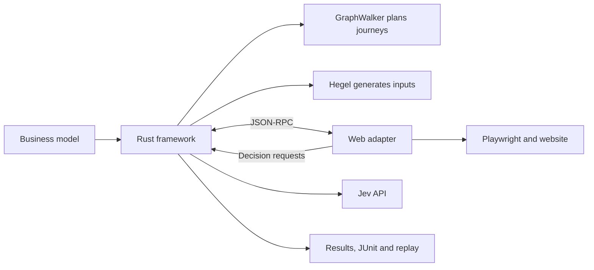

# Testwalker

Testwalker runs tests described by a GraphWalker model. The model defines states, journeys, business rules and input constraints. The framework follows those journeys, checks the results, and generates additional input tests with Hegel.

The framework is Rust. Its executable adapters communicate over JSON-RPC. The web adapter uses TypeScript, Playwright and Jev to operate a website from business descriptions, without selectors in the model. A separate discovery tool can collect observations and produce a model draft for review.

## Build and run

For the web demos, install Rust 1.88 or later, Node.js 22 or later, npm and Google Chrome. You also need a Jev API key. GraphWalker and Hegel are built into the Rust executable; they need no separate installation.

Run these commands from the repository root:

```bash
cargo build --release --locked --manifest-path core/Cargo.toml \
  --bin testwalker --bin testwalker-core
npm ci
npm run build
export PATH="$PWD/core/target/release:$PATH"
```

Create the Hello World run configuration, then edit `decision.api_key` to contain your Jev key:

```bash
cp demos/hello-world/run.json.example demos/hello-world/run.local.json
```

Keep `run.local.json` out of version control. If it already exists, edit it rather than copying over it.

Start your first test run:

```bash
./demos/hello-world/test.sh --headed
```

This starts the website and browser, executes the model and input checks, and closes both afterward. Open the printed `Report:` path to view results, screenshots and individual replay cases. Reports are saved under `demos/hello-world/artifact/`.

`--headed` makes the browser visible. The default Jev confidence threshold is **0.80**. If a decision cannot meet that threshold, the result stays inconclusive for review.

## How a run works



GraphWalker decides which journeys to execute. Jev identifies controls and checks observed states and requirements; it does not choose the next graph edge. The framework runs the graph first, then the selected property tests. Each web property attempt gets a fresh browser context and a modeled setup route. Backend reset or custom interactions can be supplied through [hooks](testwalker-web/docs/hooks.md).

| Result       | Meaning                                                                         |
| ------------ | ------------------------------------------------------------------------------- |
| PASS         | Selected checks, required graph coverage and global requirements were verified. |
| FAIL         | An executed check found a contradiction with the specification.                 |
| INCONCLUSIVE | Evidence or execution was insufficient to verify the selected work.             |

The default is fail-fast: a failed or inconclusive check stops execution. Add `--keep-going` to continue independent cases after recording that result. Dependent cases can be **SKIPPED**; this is a case status, not an overall run outcome. Shared infrastructure failures still stop the run.

See [testing and debugging](testwalker-web/docs/testing.md) for scope, budgets and replay, and [the continuation policy](core/docs/continuation.md) for recovery and dependency skips.

## Choose a starting point

| Goal                                      | Guide                                                                                |
| ----------------------------------------- | ------------------------------------------------------------------------------------ |
| Run another local example                 | [Demos](demos/README.md)                                                             |
| Test your own website                     | [Web adapter](testwalker-web/README.md)                                              |
| Write or refine a model                   | [Business model format](core/docs/model-format.md)                                   |
| Tune input generation                     | [Hegel strategies](core/docs/input-strategies.md)                                    |
| Discover pages and create a draft         | [Discovery tool](testwalker-discover/README.md)                                      |
| Build an adapter in another language      | [Architecture](core/docs/architecture.md), [adapter protocol](core/docs/protocol.md) |
| Test a JSON-RPC service without a browser | [RPC testing](core/docs/rpc-testing.md)                                              |

## Repository layout

| Folder                 | Contents                                                                                 |
| ---------------------- | ---------------------------------------------------------------------------------------- |
| `core/`                | Rust CLI, worker, graph/property engine, reports, OpenRPC contracts and self-test model. |
| `testwalker-web/`      | TypeScript web adapter, browser configuration and lifecycle extensions.                  |
| `testwalker-discover/` | Independent Crawlee/Playwright discovery and static results viewer.                      |
| `demos/`               | Local sites, their models and tests, plus the external Sauce Demo draft.                 |

The core builds with Cargo alone. The web and discovery packages build with npm. Discovery requires neither Rust nor Jev. Model authoring happens outside the runner, for example in GraphWalker Studio.

## Development checks

From the repository root, with the executables on PATH as above:

```bash
cargo test --locked --manifest-path core/Cargo.toml
testwalker self-test
npm run check
npm test
```

Optional local Chrome regression tests use deterministic test decisions and need no Jev key:

```bash
TESTWALKER_BROWSER_TESTS=1 npm test
```

The [framework guide](core/README.md) documents the standalone Rust commands. Machine-readable API contracts are checked in as [worker OpenRPC](core/openrpc.json) and [adapter OpenRPC](core/openrpc.adapter.json).
