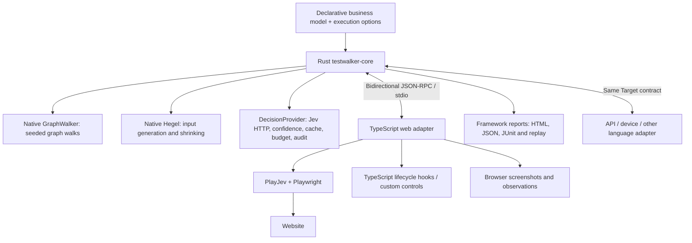

# Testwalker architecture

Testwalker separates the test framework from its execution target. A Rust library and JSON-RPC worker own graph planning, property generation, lifecycle, verdict policy, budgets, coverage, replay and every test report. The native CLI launches arbitrary adapter executables and supplies JSON-RPC testing and self-tests. TypeScript supplies the browser adapter, browser evidence and discovery CLI. The codebases share a JSON-RPC contract and have no source or build dependency on each other.

The division is similar to Cucumber: the model supplies declarative scenarios and input rules, an adapter implements target operations, and hooks provide setup or custom actions. The Rust framework schedules those operations, evaluates their results and produces reports.

## Execution ownership

1. `testwalker run` loads the model and execution configuration, configures its decision provider, and launches the supplied adapter executable. The optional `testwalker-web demo` launcher starts the local demo site and invokes this native command; it does not host the execution worker. TypeScript exposes a read-only view of the model supplied by Rust.
2. Rust calls GraphWalker to calculate complete seeded routes and plans property phases before executing a target. Generated values are chosen later by Hegel.
3. Rust asks the adapter to initialize and reset the target, fires lifecycle hooks, and issues the model's next journey intent and literal inputs.
4. The web adapter asks Jev how to operate observed controls through core decision calls. Playwright performs the operations. The adapter returns observations and prepares web-specific state/rule questions.
5. The core applies the verification policy to observed state and rule decisions. Planned visits do not count as verified coverage.
6. After graph execution, Hegel produces inputs for the selected campaigns. Rust restores each case's source state through reset and modeled setup, submits once, and verifies acceptance/rejection. Stable failures are minimized; infrastructure and confidence uncertainty are latched.
7. Rust emits case events so TypeScript can capture browser evidence. Cleanup runs on pass, failure, uncertainty and interruption. Rust collects target artifacts through JSON-RPC and writes the final HTML, JSON, JUnit and replay files.

GraphWalker chooses graph edges; Jev chooses target operations and assesses observations. A grouped walk shares state. Property cases default to independent setup. Targets that can guarantee an isolated fixture snapshot may advertise checkpoint/restore to avoid repeated setup; the web adapter uses fresh browser contexts and reset hooks instead.

## Boundaries and modules

| Module | Responsibility |
| --- | --- |
| `core/src/cli.rs`, `adapter.rs` | Native run entry point, adapter process ownership and nested framework services. |
| `core/src/model.rs` | Native model validation, business input validity and modeled setup paths. |
| `graph.rs` | Calls GraphWalker libraries and validates connected routes. |
| `properties.rs` | Hegel domain planning, generation, partition filtering and shrinking. |
| `engine.rs` | Schedules graph/property checks, hooks, isolation, coverage and replay. |
| `decision.rs` | Provider trait, Jev requests, confidence, caching, budgets and audit. |
| `protocol.rs` | Bidirectional JSON-RPC worker and cooperative cancellation. |
| `session.rs` | Shared run orchestration, output directories and artifact persistence. |
| `report.rs` | Shared HTML, JSON, JUnit and replay rendering for every target. |
| `testwalker-web/src/rpc.ts` | TypeScript transport/client and native decision proxy. |
| `adapter.ts`, `main.ts` | Executable stdin/stdout server; accepts lifecycle callbacks and makes nested decision requests. |
| `browser.ts`, `oracle.ts`, `bridge.ts` | Browser operations, web evidence and web-specific decision questions. |
| `core/src/rpc/` | Subprocess transport, declarative requests, assertions and self-model execution. |
| `core/tests/` | Rust core, wire, OpenRPC and self-test regressions. |
| TypeScript evidence capture | Captures screenshots and browser traces and returns them through JSON-RPC; it does not generate reports. |
| `discovery/` | Independent Crawlee exploration and draft model generation. |

The Rust `Target` trait and JSON-RPC contract accept observations as JSON. They do not require a DOM, browser, URL or screenshot. With the default core evaluator, the core prepares state and business-rule questions directly over those observations. The web adapter opts into the adapter evaluator for its existing detailed web semantics; its calls still go through the native provider, and Rust determines the final verdict.

The JSON-RPC adapter also uses the adapter evaluator, with exact predicates over requests and responses instead of a decision service. `testwalker-core self-test` uses this adapter to test another native worker. Both targets use the same Rust scheduler, replay rules and reporting implementation. Browser screenshots and traces are evidence supplied by TypeScript, while the framework owns the report files and their outcome totals. See [RPC testing](rpc-testing.md) and the [web demo](../../demos/README.md).

`run.start` and `case.replay` accept an optional `output` parent directory. The framework creates a run directory, announces it with the planned `run.event`, and returns its path as `report.directory`. The optional paginated `target.artifacts` callback collects additional target evidence after lifecycle cleanup. Adapters supply observations and artifacts rather than deciding how to render test results.

`DecisionProvider` is the extension point for more decision services. The current worker ships Jev only. Other providers can be added in Rust without changing target adapters. Adapters are executable paths plus literal arguments; the framework does not need a language name or a language runtime of its own. See [the CLI guide](cli.md). This version has one synchronous run per worker and stdio transport; it does not provide a background RPC server or concurrent run scheduler.

## Replay and packaging

Every planned graph test and executed input has a replay recipe with model hash, journey, input and seed. Replaying a case starts from modeled setup; graph replay verifies the selected modeled destination, while input replay calculates acceptance/rejection from concrete data. This makes triage independent of the full preceding walk.

The standalone Node project lives in `testwalker-web/`, alongside `core/`, exporting `@testwalker/web`. Applications, models and extensions live in `demos/` and do not ship in the adapter. It consumes separately installed Rust executables on PATH or explicitly configured paths; it never invokes Cargo or searches ancestor directories. Cargo and npm dependencies are pinned. Hegel is the sole property engine. JS/TS strategy callbacks return declarative domains described in [input strategies](input-strategies.md).

PlayJev's HTTP client calls a loopback bridge with an ephemeral local token. The bridge forwards requests through nested `decision.ask` RPC calls. Rust retains the real provider key, call budget, cache and audit. Playwright controls Chromium; independent web state/rule questions go through the same native provider. Literal inputs are checked against runtime-resolved controls and submitted once, including invalid data. Action verification is diagnostic and never grants verified coverage.

The Rust library, CLI, self-model, OpenRPC documents, fixtures and tests build using Cargo alone. Core tests never import browser models or JavaScript dependencies. The report viewer and serializers live with Rust. TypeScript regression tests use the public RPC interface and can consume the adapter outside the Rust checkout.
