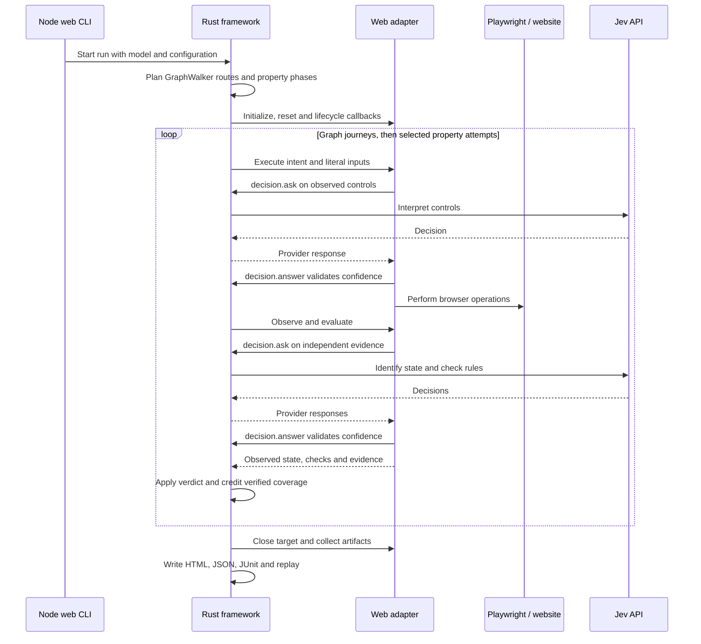

# Architecture

Testwalker separates the framework from the system being tested. A model declares flows, inputs and expected behavior. An adapter executes target operations and returns observations. Hooks provide fixture setup, custom actions or deterministic checks. Rust schedules the work and produces the results.

## Components

| Component         | Responsibility                                                                                                         |
| ----------------- | ---------------------------------------------------------------------------------------------------------------------- |
| GraphWalker       | Calculate seeded graph routes from the model and generator.                                                            |
| Hegel             | Generate inputs and minimize reproducible failures.                                                                    |
| Rust framework    | Validate models, plan scope, run lifecycle hooks, apply verdict policy, track coverage and write reports.              |
| Decision provider | Interpret evidence where needed. The shipped provider is Jev; Rust owns credentials, budgets, caching and transcripts. |
| Web adapter       | Operate Playwright, capture browser evidence, prepare Jev questions and invoke explicit JS/TS hooks.                   |
| RPC target        | Send JSON-RPC requests and evaluate exact response predicates, without a decision API.                                 |
| Discovery package | Explore websites and create draft models independently of execution.                                                   |

The diagram shows a web run. The optional Node launcher also starts and stops a local demo server. Rust launches the adapter executable; neither Node nor the adapter chooses the graph route or renders the framework reports.

## Planning and execution

Graph routes and property phases are planned before target execution. Fixed graph examples and exact boundary references are known at that point; generated Hegel values are drawn later. Planned visits do not count as verified coverage.

The graph walk shares application state between journeys. Property attempts reset their source fixture and replay a shortest modeled setup route. For the web adapter, a reset creates a fresh browser context; backend data requires an explicit reset hook. A custom adapter may advertise isolated checkpoint/restore when it can restore the entire fixture, including backend state. The web adapter does not advertise that capability.

Jev resolves browser actions, then independently identifies the observed state and checks requirements. Rust applies the final policy: a contradiction is FAIL, insufficient evidence is INCONCLUSIVE, and PASS requires the selected checks, requested coverage and every global requirement. The RPC target uses exact predicates instead of Jev for its checks.

Failures can be reproduced and shrunk. Inconclusive target/provider errors stop the campaign and preserve the original case. Hegel replay consumes the same generator choices without repeating a latched target call.

## Executable and transport boundary

`testwalker run` accepts any executable adapter, with literal arguments. There is no language setting. The [protocol](protocol.md) is bidirectional JSON-RPC 2.0 over stdin/stdout, one JSON object per line. The adapter can call framework services while handling a callback.

The native CLI defaults to the adapter evaluator. With `--evaluator core`, Rust prepares decision questions directly from JSON observations. The web adapter prepares questions for its richer browser evidence and sends them through the same Rust provider. The built-in RPC target prepares deterministic checks. All use the same scheduler and reports.

One worker handles one synchronous run at a time. There is no concurrent case scheduler. Other decision providers can implement the Rust `DecisionProvider` trait; the supplied worker currently ships Jev.

## Code map

Paths below are relative to the repository root.

| Path                                                                                                                              | Responsibility                                                                  |
| --------------------------------------------------------------------------------------------------------------------------------- | ------------------------------------------------------------------------------- |
| `core/src/model.rs`, `core/src/configuration.rs`                                                                                  | Model validation, business validity, setup paths and exploration configuration. |
| `core/src/graph.rs`, `core/src/properties.rs`                                                                                     | GraphWalker routes and Hegel input strategies.                                  |
| `core/src/engine.rs`                                                                                                              | Scheduling, hooks, isolation, verification and replay.                          |
| `core/src/decision.rs`                                                                                                            | Provider requests, confidence gates, cache, budget and transcript.              |
| `core/src/cli.rs`, `core/src/adapter.rs`, `core/src/protocol.rs`                                                                  | CLI, executable adapters and worker services.                                   |
| `core/src/session.rs`, `core/src/report.rs`, `core/assets/`                                                                       | Report persistence, JUnit, replay files and viewer.                             |
| `core/src/rpc/`, `core/models/rpc-selftest.json`                                                                                  | JSON-RPC testing and the bundled self-test.                                     |
| `testwalker-web/src/cli.ts`, `testwalker-web/src/main.ts`, `testwalker-web/src/adapter.ts`, `testwalker-web/src/rpc.ts`           | Web launcher and adapter transport.                                             |
| `testwalker-web/src/browser.ts`, `testwalker-web/src/controls.ts`, `testwalker-web/src/inputs.ts`, `testwalker-web/src/oracle.ts` | Browser operations, observations and decision questions.                        |
| `testwalker-web/src/extensions.ts`                                                                                                | Explicit hooks and custom input domain providers.                               |
| `testwalker-discover/src/`                                                                                                        | Independent website exploration, model export and viewer.                       |

The core builds with Cargo alone. The Node packages consume installed executables through JSON-RPC and do not compile Rust. Demo sites and their models live outside the packages in `demos/`.

Continue with [the CLI](cli.md), [the adapter contract](protocol.md), or [RPC testing](rpc-testing.md).
