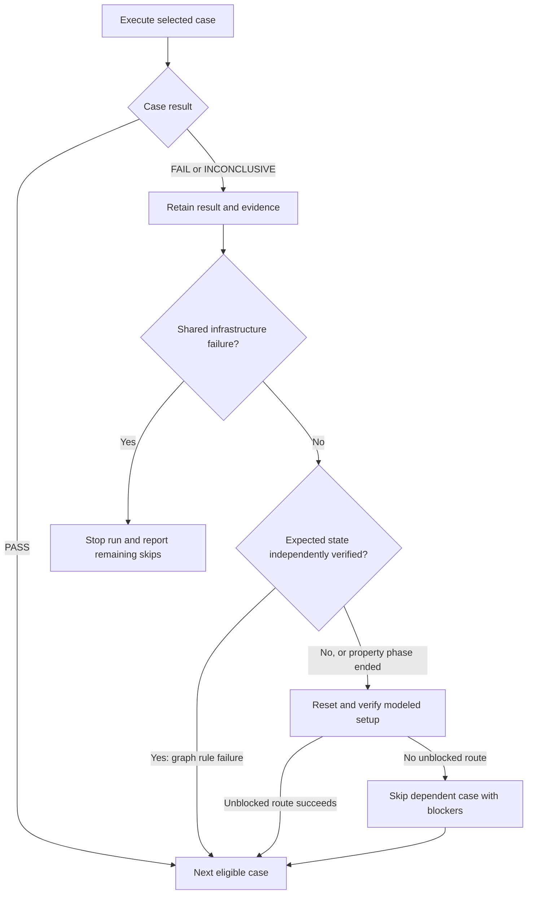

# Keep-going execution

Fail-fast remains the default. `--keep-going`, or `options.keep_going: true` in the run configuration, records failed and inconclusive cases and continues independent selected work. The Rust scheduler owns this policy for every adapter. It does not lower confidence thresholds, repair inputs or award coverage for an intended destination. Failed graph operations are not automatically retried; property failures retain Hegel's reproduction and shrinking behavior.

```bash
./demos/trailhead/test.sh --headed --keep-going
```

To enable this in an existing configuration, add `"keep_going": true` inside its `options` object. CLI flags override configuration. The overall run can still finish FAIL or INCONCLUSIVE after continuing: keep-going collects more evidence, rather than changing verdicts.



The diagram describes keep-going. Property defects finish their current phase after reproduction/shrinking; setup itself can also fail and is reported as an inconclusive attempted case.

## Graph execution

A graph case is the initial state check, or one modeled transition followed by its destination check. Passing cases normally share the same application fixture within a walk.

- If a business requirement fails or remains uncertain but the destination is independently identified as the expected state, record the failure and continue navigation from that known state. The failed case does not earn verified coverage.
- If an operation fails, the destination is wrong, or state identification is uncertain, stop using the current fixture. Record that fixed graph scenario as a blocked prerequisite.
- Before a later graph case, reset the fixture and replay a nominal setup route to its source, avoiding blocked fixed scenarios. Verify every setup checkpoint before executing the case. If no unblocked route reaches the source, skip the dependent case and name its blocking tests.
- The blocked scenario is a modeled transition with its fixed example, not the whole node or every possible input. A property failure after submission does not create a graph block. A failed initial-state prerequisite blocks cases requiring that initial fixture.

Recovery chooses a nominal setup route through unblocked model transitions; it does not ask Jev to invent a journey or generate a new GraphWalker walk. Planning must succeed first: keep-going cannot repair a disconnected or terminal graph that its selected generator cannot traverse.

Recovery uses the same nominal setup semantics as individual replay: the model's states and hooks must describe the business prerequisites, including backend fixtures. A different URL alone is insufficient. Unmodeled history cannot be restored automatically. Setup transitions are evidence for recovery, not additional planned graph tests, and do not earn graph coverage.

For example, failing to reach a booking confirmation may block cancellation routes that need that booking. Profile editing can continue after an independent reset and verified setup. A refund-rule failure on a confidently identified cancellation screen need not block navigation back to the menu.

## Property phases

Graph traversal runs before the selected Hegel phases. Each property attempt establishes its own source fixture through reset/setup, or an adapter's verified isolated checkpoint.

When Hegel finds a defect, it retains normal reproduction and shrinking behavior, then finishes that phase as failed and moves to the next selected phase. It does not keep generating examples inside the same failed phase to hide the counterexample. An inconclusive submission similarly ends its phase and permits independent phases to continue. Invalid submitted data is never reused as setup data for another phase.

Discard the campaign checkpoint after any failed or inconclusive phase. A failure while replaying setup is an inconclusive setup result for the attempted phase; subsequent phases are skipped only if no unblocked modeled route reaches their source. An alternative verified route can still establish the fixture. Other forms and reachable source states remain eligible. A post-submission property failure does not block other phases using the same form.

## Run-wide stops

Keep-going does not continue after a shared infrastructure failure: an exhausted provider or input-attempt allowance, provider transport/configuration failure, disconnected or invalid adapter transport, cancellation, failed reset, or failure to persist execution events. Target initialization and the `before_run` hook must succeed before cases can execute. A walk-specific hook failure can still permit other walks or property phases when it is not a shared infrastructure failure.

Reset and lifecycle hooks still run at their normal boundaries. Cleanup failures are retained separately and cannot erase the original defect. If reproduction or shrinking encounters later uncertainty or a shared infrastructure fault, retain the earlier definite counterexample and mark minimization incomplete. A shared fault still stops the run. The configured budgets remain shared across all work, recovery and shrinking; keep-going does not replenish them. Unselected input phases remain outside scope.

## Results and triage

Each executed case keeps its own outcome, inputs, observed state, rule checks, attachments and replay recipe. Skipped cases name their blocking tests or the terminal infrastructure stop. Reports distinguish case failures from the eventual reason the scheduler stopped, so a later provider error does not replace an earlier defect.

The overall outcome is **FAIL** when any definite defect was observed; otherwise **INCONCLUSIVE** when selected work or required coverage/global requirements remain unresolved; otherwise **PASS**. Later passing cases cannot erase an earlier failure. HTML, JSON and JUnit retain multiple failures and dependency skips.

Recovered graph cases and property attempts retain the actual setup route, including any recovery alternative, and validate its connections against the saved model before starting the target. Ordinary graph cases retain their existing nominal source-setup replay semantics rather than embedding the whole accumulated walk. Individual replay still executes just its saved case. Keep-going is a scheduling policy for a suite, not an automatic retry policy.
