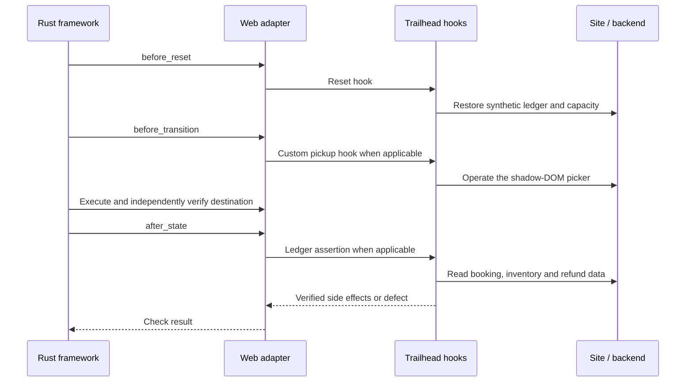

# Trailhead

A synthetic travel centre with 20 states, 148 journeys and three input data sets. It covers adventure information, member profiles, planning/review, final booking, cancellation and refunds.

The [model](model.json) is the business specification. A TypeScript [backend](app.ts) stores the demo ledger, and [hooks](hooks.ts) reset fixtures, operate a bespoke pickup picker and verify backend side effects.

## Run

After [setup](../../README.md#build-and-run), run from the repository root. Create the configuration once and set `decision.api_key`:

```bash
cp demos/trailhead/run.json.example demos/trailhead/run.local.json
```

Edit `decision.api_key` in the new file, then run:

```bash
./demos/trailhead/test.sh --headed
```

The script loads the backend and hooks and uses port 4184. Defaults cover the full graph and all 186 focused input phases across seven campaigns, with a 10000-call Jev allowance. Reports go to `demos/trailhead/artifact/`; the owned browser and server close afterward.

Full graph with only two generated inputs:

```bash
./demos/trailhead/test.sh --headed \
  --input-mode generated --cases 1 --max-input-attempts 2 \
  --no-shrink --max-calls 4000
```

Add `--keep-going` to collect independent results after case failures. Shared infrastructure failures still stop execution; see [the continuation policy](../../core/docs/continuation.md).

For a short booking/cancellation/profile route:

```bash
./demos/trailhead/test.sh --headed \
  --generator predefined_path --edge-coverage 0 --state-coverage 0 \
  --max-input-attempts 2 --no-shrink --max-calls 1000
```

The zero coverage targets intentionally select a shorter scenario. A pass on that route does not mean all 148 journeys were verified. See [scope and results](../../testwalker-web/docs/testing.md).

## What the hooks demonstrate



The pickup hook selects an option by manipulating the real widget. App-specific selectors stay in the hook rather than the model. Jev still verifies the resulting state.

Ledger assertions check that review does not reserve places, final confirmation reserves exactly the submitted quantity and charges the modeled amount, invalid submissions have no ledger effect, and cancellation restores capacity and issues one full refund.

## Demonstrate defect detection

The backend has documented synthetic defect switches. These runs should FAIL at the ledger assertion:

```bash
TRAILHEAD_DEMO_BUG=inventory ./demos/trailhead/test.sh \
  --generator predefined_path --edge-coverage 0 --state-coverage 0 \
  --input-mode none --max-calls 1000

TRAILHEAD_DEMO_BUG=refund ./demos/trailhead/test.sh \
  --generator predefined_path --edge-coverage 0 --state-coverage 0 \
  --input-mode none --max-calls 1000
```

Omit the environment prefix to use the healthy backend. Each test run resets its own fixture through the hook.

## Discover a model draft

Discovery needs no Jev key or Rust executable. After building the Node packages, run from the repository root:

```bash
./demos/trailhead/discover.sh --headed
```

The script starts and stops the local site automatically, using a free port. It writes a new `discovered-<timestamp>-<pid>.model.json` beside the existing model, with its viewer and captures under `artifact/`. Review the draft before executing it; the existing model is unchanged. Both `test.sh` and `discover.sh` accept CLI options; see [the script guide](../README.md#shell-scripts) for overrides.

## Plan, preview and regression checks

```bash
npx --no-install testwalker-web plan --directory demos/trailhead
npx --no-install testwalker-web serve --directory demos/trailhead/site \
  --app demos/trailhead/app.ts --port 4184
npm test --workspace @testwalker/demo-trailhead
TESTWALKER_BROWSER_TESTS=1 npm test --workspace @testwalker/demo-trailhead
```

Stop preview before testing on its port, or append another `--port` to the demo. The [input strategy policy](input-strategies.json) demonstrates per-field Hegel tuning. For discovery examples, see [the separate discovery guide](discovery/README.md).
