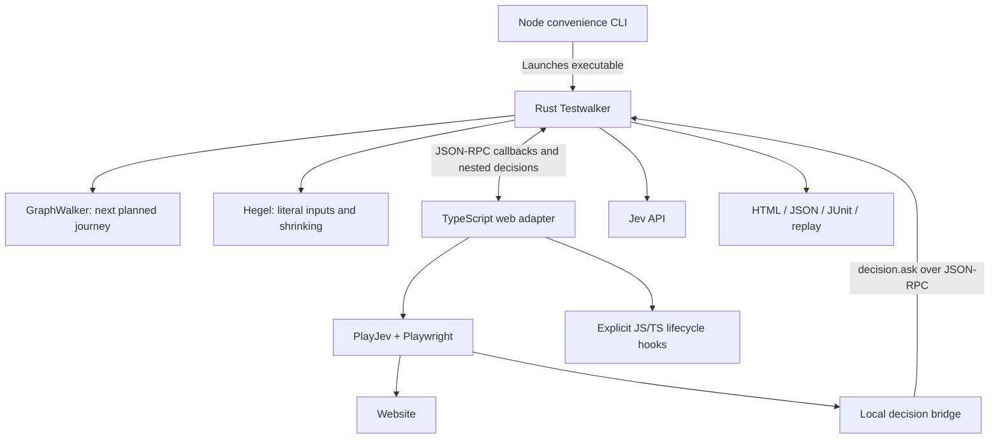

# Testwalker web adapter

A TypeScript/JavaScript client for the Rust Testwalker framework. It uses [PlayJev](https://github.com/filedcom/playjev) and Playwright for browser interactions, and JavaScript Crawlee for discovery. No Python, Browser Use or MCP server is required. PlayJev 0.1.0 is experimental and pinned.

Rust still owns GraphWalker exploration, Hegel generation and shrinking, lifecycle scheduling, Jev credentials/call budgets, verdict policy, replay, and HTML/JSON/JUnit reports. The adapter implements the executable [JSON-RPC contract](../core/docs/protocol.md). It has no Rust source/build dependency and ships no demo applications.

## Install locally

Requires Node.js 22+, npm, Google Chrome, and the separately built/installed Rust framework. Nothing is published.

```bash
# Repository root
npm ci
npm run build
cd core
cargo build --release --locked --bin testwalker --bin testwalker-core
cd ..
export PATH="$PWD/core/target/release:$PATH"
cp demos/hello-world/run.json.example demos/hello-world/run.local.json
# Set decision.api_key in the ignored run.local.json to your Jev key.
npx --no-install testwalker-web demo --directory demos/hello-world --headed
```

`node testwalker-web/dist/cli.js` is an equivalent invocation. The test browser/context closes at exit. `--keep-target-open` is not supported by this adapter; use `--headed` and report screenshots for debugging.

The Rust executable is selected by `--framework /absolute/path/to/testwalker`, `TESTWALKER_BIN`, or PATH. Public `CoreClient` utilities use `TESTWALKER_CORE_BIN` or `testwalker-core` on PATH. Neither searches the checkout nor runs Cargo.

## Run your model

Start the application separately, then:

```bash
npx --no-install testwalker-web run --model model.json \
  --url http://localhost:3000 --config run.local.json --headed \
  --generator new_york_street_sweeper --max-steps 1000 \
  --max-input-attempts 2 --no-shrink --max-calls 4000
```

The configuration is the framework's [native run JSON](../core/docs/cli.md#run-configuration). Provider settings stay in Rust; the launcher sends them through stdin. Existing `demos/*/run.local.json` files remain usable. Defaults include confidence **0.80** and focused Hegel input checks. Graph, property and replay flags pass directly to Rust. Use `--plan` to inspect the selected inventory without a key or browser.

The CLI commands are `run`, `demo`, `plan`, `serve`, `discover-url`, and `discover-sitemap`. `--directory` identifies an application folder containing `site/`, `model.json` and the run configuration. `--app` explicitly loads a JavaScript/TypeScript backend exporting `create_server(directory)`. `--hooks` explicitly loads application lifecycle functions; they are never imported from the model.

## Browser configuration

Use `--browser-config browser.json`. Demo folders supply one:

```json
{
  "launch": {"channel": "chrome"},
  "context": {
    "viewport": {"width": 1120, "height": 780},
    "ignoreHTTPSErrors": false
  },
  "action_timeout_ms": 15000,
  "navigation_timeout_ms": 30000,
  "settle_ms": 150,
  "settle_timeout_ms": 5000
}
```

`launch` and `context` accept Playwright Chromium launch/context options. Relative `launch.executablePath` is resolved against the configuration file. `--headed` overrides headless startup. PlayJev and DOM capture require Chromium; Firefox/WebKit are not supported. This adapter uses fresh nonpersistent browser contexts; persistent-profile extensions require a separate integration.

Execution can attach to externally managed Chromium using `--cdp-url http://127.0.0.1:9222`. It creates its own context and does not close other tabs. Discovery launches its own browser and does not support CDP attachment.

Before execution observations, the adapter waits for document/XHR/fetch requests to finish and for the rendered text and form values to remain stable for `settle_ms` (default 150 ms), within `settle_timeout_ms` (default 5 seconds). This prevents assertions against an unfinished asynchronous save. A timeout is inconclusive. Set `settle_ms` to 0 to disable the settling wait, for example on a site with continuous background requests. DOM evidence is captured together and checked against the accessibility snapshot; changing evidence is inconclusive rather than a mixture of two pages.

## Who calls whom



PlayJev finds controls from observed browser evidence. The model contains business intents and constraints, without selectors. A loopback bridge routes PlayJev's decision requests through Rust so its provider budget, cache and audit cover **all** Jev calls. The bridge uses a temporary local token; the real API key remains in Rust.

Independent state identification and business-rule checks establish the outcome. PlayJev's action verification is retained as diagnostic evidence. Intentionally invalid inputs are entered literally, checked for exact entry, and submitted once; they are never repaired to make an action check succeed.

After Jev binds the fields, standard HTML forms with exactly one visible, enabled submit control are submitted through that control's normal Playwright click. This uses the observed HTML form association, including external controls with a `form` attribute. Ambiguous submit controls or custom forms still use PlayJev. Submission is never retried, and the independent state and rule checks verify the outcome. No selectors need to be added to the model.

If PlayJev cannot choose between navigation links before taking an action, the adapter can ask Jev to choose among observed destinations, grouping links that share a URL. It then uses a named navigation link for that destination. Both choices retain the configured confidence threshold; the independent state check still decides whether the journey succeeded. This fallback never retries form entry, submission, or an operation that may already have executed.

Resolved navigation hints are reused within the run while their accessible name, navigation region and URL still identify one observed link. Changed or ambiguous controls discard the hint. Reuse only makes the next PlayJev instruction more specific; it does not bypass Jev confidence or destination assertions. Reports record both disambiguation and hint reuse.

Global audits distinguish newly submitted inputs from values retained during navigation. An uncertain batch of observations can be checked once as individual scenarios. The report retains the original answer and each focused answer; any contradiction or remaining uncertainty still prevents a pass. Absent evidence never counts as support.

See [testing and triage](docs/testing.md), [JS/TS hooks](docs/hooks.md), [discovery](docs/discovery.md), and [self-contained demos](../demos/README.md).

## Development

```bash
npm run build
npm run check
export PATH="$PWD/core/target/release:$PATH"
npm test
# Optional local Chrome checks; no Jev key required:
TESTWALKER_BROWSER_TESTS=1 npm test
```

The workspace links `@testwalker/web` locally. Its public exports include `HookContext`, `Hooks`, `Defect`, `Inconclusive`, `CoreClient`, `JsonRpcPeer`, `serve`, `staticServer`, `observe`, `discoverUrl` and `discoverSitemap`. User extensions may be `.js`, `.mjs`, or `.ts`; TypeScript extensions are loaded with the bundled tsx runtime. Keep stdout reserved for JSON-RPC when implementing an adapter; this entry point redirects console output to stderr.
