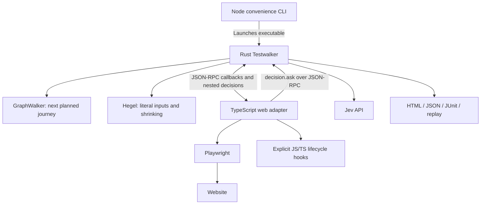

# Testwalker web adapter

A TypeScript/JavaScript client for the Rust Testwalker framework. It uses Playwright for browser interactions, Jev to interpret observed controls and business evidence, and JavaScript Crawlee for discovery. The browser executor is part of this package; PlayJev, Python, Browser Use and an MCP server are not required.

Rust still owns GraphWalker exploration, Hegel generation and shrinking, lifecycle scheduling, Jev credentials/call budgets, verdict policy, replay, and HTML/JSON/JUnit reports. The adapter implements the executable [JSON-RPC contract](../core/docs/protocol.md). It has no Rust source/build dependency and ships no demo applications.

## Install locally

Requires Node.js 22+, npm, Google Chrome, and the separately built/installed Rust framework. Nothing is published.

```bash
# Repository root
npm ci
npm run build
cd core
cargo build --release --locked --bin testwalker --bin testwalker-core
cd ..
export PATH="$PWD/core/target/release:$PATH"
cp demos/hello-world/run.json.example demos/hello-world/run.local.json
# Set decision.api_key in the ignored run.local.json to your Jev key.
npx --no-install testwalker-web demo --directory demos/hello-world --headed
```

`node testwalker-web/dist/cli.js` is an equivalent invocation. The test browser/context closes at exit. `--keep-target-open` is not supported by this adapter; use `--headed` and report screenshots for debugging.

The Rust executable is selected by `--framework /absolute/path/to/testwalker`, `TESTWALKER_BIN`, or PATH. Public `CoreClient` utilities use `TESTWALKER_CORE_BIN` or `testwalker-core` on PATH. Neither searches the checkout nor runs Cargo.

## Run your model

Start the application separately, then:

```bash
npx --no-install testwalker-web run --model model.json \
  --url http://localhost:3000 --config run.local.json --headed \
  --generator new_york_street_sweeper --max-steps 1000 \
  --max-input-attempts 2 --no-shrink --max-calls 4000
```

The configuration is the framework's [native run JSON](../core/docs/cli.md#run-configuration). Provider settings stay in Rust; the launcher sends them through stdin. Existing `demos/*/run.local.json` files remain usable. Defaults include confidence **0.80** and focused Hegel input checks. Graph, property and replay flags pass directly to Rust. Use `--plan` to inspect the selected inventory without a key or browser.

The CLI commands are `run`, `demo`, `plan`, `serve`, `discover-url`, and `discover-sitemap`. `--directory` identifies an application folder containing `site/`, `model.json` and the run configuration. `--app` explicitly loads a JavaScript/TypeScript backend exporting `create_server(directory)`. `--hooks` explicitly loads application lifecycle functions; they are never imported from the model.

## Browser configuration

Use `--browser-config browser.json`. Demo folders supply one:

```json
{
  "launch": {"channel": "chrome"},
  "context": {
    "viewport": {"width": 1120, "height": 780},
    "ignoreHTTPSErrors": false
  },
  "action_timeout_ms": 15000,
  "navigation_timeout_ms": 30000,
  "settle_ms": 150,
  "settle_timeout_ms": 5000
}
```

`launch` and `context` accept Playwright Chromium launch/context options. Relative `launch.executablePath` is resolved against the configuration file. `--headed` overrides headless startup. The executor currently supports Chromium; Firefox/WebKit are not supported. This adapter uses fresh nonpersistent browser contexts; persistent-profile extensions require a separate integration.

Execution can attach to externally managed Chromium using `--cdp-url http://127.0.0.1:9222`. It creates its own context and does not close other tabs. Discovery launches its own browser and does not support CDP attachment.

Before execution observations, the adapter waits for document/XHR/fetch requests to finish and for relevant DOM activity to remain quiet for `settle_ms` (default 150 ms), within `settle_timeout_ms` (default 5 seconds). A continuous mutation observer tracks the last change, so repeated reads of an already settled page do not restart the quiet interval. This prevents assertions against an unfinished asynchronous save. A timeout is inconclusive. Set `settle_ms` to 0 to disable the settling wait, for example on a site with continuous background requests. Rendered text, controls and validation evidence are captured together. A Playwright accessibility snapshot for each visible frame preserves static relationships such as definition-list labels and values. Freshness checks reject page changes during capture. These observations provide evidence for assertions; they do not perform an accessibility audit.

## Who calls whom



The adapter captures browser controls and asks Jev to rank the available click actions independently in one request: unrelated, contextual, indirect, or direct. Only a confidently direct target qualifies. Action decisions use compact control evidence and the graph's intended destination; outcome assertions use the full independent page observation. This avoids confusing existing business results with the next operation. Each differently labelled control is assessed separately, even if its URL matches another link. When independently approved links have the same destination and browser target, navigation links take precedence. Other competing actions use one focused choice. If only uncertain candidates remain, one focused clarification is allowed before any interaction; unresolved evidence stays inconclusive. Every accepted answer uses the configured confidence threshold. Native score responses retain their original confidence and probabilities; the adapter adds their most probable level for validation by the existing Rust decision service. Malformed replies and provider failures stop execution without clarification. Native field bindings are also batched; operations use the selected control type: fill text, check a checkbox or radio, or select an option. The model contains business intents and constraints, without selectors. Decision requests go directly through the existing Rust JSON-RPC service, so the core's provider budget, cache, confidence policy and audit cover **all** Jev calls. No local HTTP bridge or provider credentials are needed in the web executor.

The executor performs normal Playwright actions on observed controls. It does not execute JavaScript supplied by Jev. It checks that selected controls are still present and actionable before changing the page, and stops when evidence is ambiguous or below the configured confidence threshold. Bespoke dropdowns and other custom widgets require the existing explicit lifecycle hooks; automatic multi-step widget interactions are not supported.

Jev binds input fields from their observed labels and descriptions. Inputs are entered literally, including intentionally invalid values, and checked for exact entry. Standard HTML forms with exactly one visible, enabled submit control use that control's normal Playwright click, including controls linked with a `form` attribute. Ambiguous or custom form submissions require a decision from the observed controls. Submission is performed once; rejected values are never repaired or submitted again within the attempt.

Independent state identification and business-rule checks establish the outcome after execution. The executor does not add a second action-verification call. Cached control bindings are only reusable while a fresh observation still identifies the same unique control; changed or ambiguous evidence requires a new decision. Destination and business-rule checks still run after the action.

Reports include a `performance` trace entry with counts and elapsed milliseconds for observations, DOM capture, action decisions, browser interactions, assertions, audit and screenshots. Observation timing includes DOM capture, so these totals overlap and must not be added together as wall time. No parallel decision service or protocol changes are required in Rust.

Global audits distinguish newly submitted inputs from values retained during navigation. An uncertain batch of observations can be checked once as individual scenarios. The report retains the original answer and each focused answer; any contradiction or remaining uncertainty still prevents a pass. Absent evidence never counts as support.

See [testing and triage](docs/testing.md), [JS/TS hooks](docs/hooks.md), [discovery](docs/discovery.md), and [self-contained demos](../demos/README.md).

## Development

```bash
npm run build
npm run check
export PATH="$PWD/core/target/release:$PATH"
npm test
# Optional local Chrome checks; no Jev key required:
TESTWALKER_BROWSER_TESTS=1 npm test
```

The workspace links `@testwalker/web` locally. Its public exports include `HookContext`, `Hooks`, `Defect`, `Inconclusive`, `CoreClient`, `JsonRpcPeer`, `serve`, `staticServer`, `observe`, `discoverUrl` and `discoverSitemap`. User extensions may be `.js`, `.mjs`, or `.ts`; TypeScript extensions are loaded with the bundled tsx runtime. Keep stdout reserved for JSON-RPC when implementing an adapter; this entry point redirects console output to stderr.
