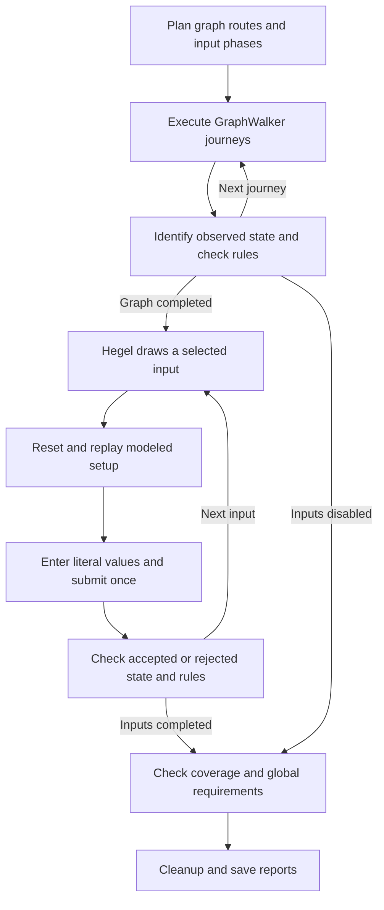

# Running tests and understanding results

Run web commands from the repository root after [setup](../../README.md#build-and-run). A model defines the specification; the run configuration selects how much of it to exercise.

## Execution flow



By default, the runner stops on a defect or an unverifiable selected check, then cleans up and writes the available results. With `--keep-going`, it retains that result and continues independent selected work through verified setup.

- **GraphWalker** plans which graph edges to execute. Jev does not choose the next edge.
- **The web adapter and Playwright** operate controls selected from current browser observations.
- **Jev** independently identifies the observed state and checks business requirements. State identification does not receive the expected destination.
- **Hegel** draws input values and minimizes reproducible failures.
- **Rust** schedules execution, calculates input validity, applies verdict policy, tracks coverage and writes reports.

Graph routes and property phases are planned upfront. Fixed graph examples and exact boundary references are known then; generated values are drawn during execution. Only independently verified destinations and rules earn graph coverage.

A business state is more specific than a URL. A form ready for entry, that form displaying errors and a review awaiting confirmation can be different states on the same page. Visiting every edge does not exercise every possible path through the graph.

## Keep going after case failures

```bash
./demos/trailhead/test.sh --headed --keep-going
```

Use `--keep-going`, or `options.keep_going: true` in `run.local.json`, to continue independent cases. A failed or uncertain rule at a confidently identified destination need not interrupt navigation; failed or uncertain navigation requires fresh setup before later cases. Routes with failed fixed prerequisites are skipped and name the blocking tests. GraphWalker still supplies the planned graph cases, and recovery uses modeled setup routes rather than guessed navigation.

A property submission failure ends its Hegel phase after normal reproduction/shrinking; other reachable phases continue from clean fixtures. Property failures do not blacklist graph edges or the form. Shared provider/transport failures, failed reset, cancellation and exhausted execution allowances still stop the run. A definite counterexample remains a failure if shrinking is interrupted.

Reports keep each case's own evidence, multiple failures, recovery paths and dependency-based skip reasons. Overall FAIL takes precedence over later uncertainty or passing cases. See [the detailed continuation policy](../../core/docs/continuation.md).

## Input testing and setup

A data-submission journey references a data set and accepted/rejected states. The framework calculates validity from those independent constraints. Valid inputs must reach acceptance; invalid inputs must reach rejection with explanations identifying the affected fields.

Journeys with the same source state, data set and outcomes share a property **campaign**. A **phase** tests one generated strategy or constraint partition within that campaign. An **attempt** is one concrete submission, including reproduction or shrinking.

Each property attempt opens a fresh browser context and replays a modeled setup route from the start. It does not rely on the previous test remaining at the form. Fresh contexts clear cookies and browser storage; use a [reset hook](hooks.md) for backend fixtures. Graph journeys within one walk intentionally share state.

Inputs are entered literally and checked before submission, with surrounding whitespace trimming only where the model permits it. Submission happens once per attempt. Hegel may run separate attempts to reproduce or shrink a failure. The adapter does not correct invalid values or retry the form to make the case pass.

## Choose input scope

| Mode         | Selected work                                                                                                         |
| ------------ | --------------------------------------------------------------------------------------------------------------------- |
| `focused`    | Default. Hegel generates within individual constraint partitions, changing one field while others use valid examples. |
| `boundaries` | Exact reference values for the same boundary partitions, executed through Hegel.                                      |
| `generated`  | Broad generated phases for each field, plus a combined-field phase.                                                   |
| `all`        | Broad generated phases plus exact boundary phases.                                                                    |
| `none`       | No separate property campaigns. Fixed form inputs on graph journeys still execute.                                    |

Focused checks cover required blanks/whitespace, optional blanks, numeric and length limits at −1/equal/+1, malformed numeric/email values, allowed and unlisted choices, and surrounding whitespace. Valid neighbors detect over-validation too. Duplicate reference submissions are planned once within a campaign.

`--cases N` requests up to N generated examples **per phase**, not per form or run. A three-field broad campaign has four generated phases, so `--cases 20` offers up to 80 inputs. Finite domains can finish sooner; a blank-only phase has one distinct value.

`--max-input-attempts N` selects the first property phases/examples in model order before execution, and also bounds reproduction and shrinking. Excluded phases are **outside scope**, not skipped tests. Two selected inputs can produce PASS when all selected checks, graph coverage and global requirements pass. They do not cover every field or campaign.

An observed defect remains FAIL if the allowance runs out during minimization; the report marks that input as not proven minimal. Uncertain outcomes remain inconclusive. See [Hegel strategies](../../core/docs/input-strategies.md) for per-field policies and custom domains.

## Run Trailhead

Prepare `demos/trailhead/run.local.json` as shown in the [Trailhead guide](../../demos/trailhead/README.md). The demo script loads the backend and hooks.

Full graph with two selected generated inputs:

```bash
./demos/trailhead/test.sh --headed \
  --generator new_york_street_sweeper \
  --edge-coverage 100 --state-coverage 100 --max-steps 1000 \
  --input-mode generated --cases 1 --max-input-attempts 2 \
  --no-shrink --max-calls 4000
```

Full graph with the model's focused partitions:

```bash
./demos/trailhead/test.sh --headed \
  --input-mode focused --cases 1 --max-input-attempts 1000 \
  --max-calls 10000
```

The current model offers 186 focused phases across seven campaigns. For broader sampling, use `--input-mode generated --cases 3`, or `--input-mode all` to add exact boundaries. Inspect the plan before increasing scope substantially.

## Budgets and coverage

Configuration values override defaults; explicit CLI flags override configuration.

| Option                                    | Meaning                                                                                                                     |
| ----------------------------------------- | --------------------------------------------------------------------------------------------------------------------------- |
| `--generator`                             | GraphWalker name or expression. See [walk modes](../../core/docs/cli.md#graph-walk-modes).                                  |
| `--seed N`                                | Graph/input seed; default 42. Browser behavior and Jev decisions can still vary.                                            |
| `--edge-coverage N`, `--state-coverage N` | Required verified percentages; the demo models request 100%.                                                                |
| `--walks N`                               | Independently reset graph walks; default 1. Campaigns run after the walks.                                                  |
| `--max-steps N`                           | Graph elements per planned walk; CLI default 1000. States, edges and repeat visits count.                                   |
| `--cases N`                               | Generated examples per phase; default 1.                                                                                    |
| `--max-input-attempts N`                  | Input scope and reproduction/shrink allowance; default 1000.                                                                |
| `--max-calls N`                           | **Whole-run Jev call allowance**, including setup and audits. Default 1000 unless the run configuration sets another value. |
| `--max-actions N`                         | Control operations per journey; default 25.                                                                                 |
| `--threshold N`                           | Minimum decision confidence; default 0.80.                                                                                  |
| `--no-shrink`                             | Disable shrinking; failure reproduction can still occur.                                                                    |
| `--headed`                                | Show the browser; owned resources still close at completion.                                                                |

If a planned route exceeds the step allowance, planning fails before browser execution. A terminal or disconnected graph may require model changes rather than a larger budget. If the Jev or action allowance prevents verification of selected work, the run is inconclusive. One input attempt may use many Jev calls for setup, actions and checks.

## Results and reports

| Result        | Meaning                                                                                                                                          |
| ------------- | ------------------------------------------------------------------------------------------------------------------------------------------------ |
| PASS          | Selected checks, requested graph coverage and every global requirement were verified.                                                            |
| FAIL          | An executed check found a contradiction, such as a wrong destination, invalid data accepted or a failed backend assertion.                       |
| INCONCLUSIVE  | Selected work could not be verified: uncertain state/rule, failed setup, provider error, insufficient coverage or an exhausted execution budget. |
| SKIPPED       | A selected case was blocked by a failed prerequisite or not reached after a run-wide stop. This is a case status, not an overall run result.     |
| Outside scope | Work excluded by configuration; not counted as skipped.                                                                                          |

All individual cases can pass while a global requirement or cleanup error makes the overall run non-passing. Unverified requirements produce INCONCLUSIVE; definite contradictions produce FAIL. JUnit includes a run-outcome case to expose that distinction. A property setup failure is inconclusive because the candidate's starting state was not established.

Open the printed `Report:` path. By default, output is beside the supplied model:

```text
model.json
artifact/
  2026-10-13T02-19-25.969Z-49708-0/
    report.html
    report.json
    junit.xml
    model.json
    plan.json
    screenshots/
    evidence/
    replays/
```

Each run folder starts with a UTC timestamp and includes a process ID and sequence number to avoid collisions. Asset folders are created when needed. `--output DIR` overrides the parent folder; existing reports stay at their original locations. Keep the whole run directory together:

| File           | Contents                                                                             |
| -------------- | ------------------------------------------------------------------------------------ |
| `report.html`  | Graph, cases, inputs, screenshots, rules, actions and expandable decisions.          |
| `report.json`  | Machine-readable results, coverage, scope, failures, recovery and skip/stop reasons. |
| `plan.json`    | Planned graph checks and property phases.                                            |
| `model.json`   | Effective model used for this run.                                                   |
| `junit.xml`    | CI case statuses, run outcome and failure/error/skip evidence.                       |
| `screenshots/` | Screenshots captured for executed checks and attempts when enabled.                  |
| `evidence/`    | Decision transcripts loaded on demand by the viewer.                                 |
| `replays/`     | Individual concrete graph/property recipes.                                          |

The viewer opens directly from disk without a server. JUnit groups generated attempts by phase, so its case count can differ from submission count. Property coverage distinguishes completed selected phases from completed full campaigns.

## Debug a failed or inconclusive run

1. Read the run outcome and affected cases. With keep-going, a non-passing run may have completed all selected work.
2. Inspect each affected case's expected/observed state, input, rule answers, confidence and screenshot. A later terminal stop is separate from earlier failures.
3. For skipped cases, inspect `blocked_by` or the terminal stop reason. Check the plan to distinguish incomplete selected work from outside-scope phases.
4. Correct the stated issue: model ambiguity, missing backend reset, unavailable control, provider error or the specific exhausted allowance.
5. Replay the concrete case to verify the correction.

Plan without a key or browser:

```bash
npx --no-install testwalker-web plan --directory demos/trailhead \
  --generator new_york_street_sweeper --max-steps 1000
```

Replay a local Trailhead case using absolute report paths:

```bash
./demos/trailhead/test.sh \
  --model /absolute/path/to/run/model.json \
  --replay /absolute/path/to/run/replays/case.json --headed
```

Use the saved effective model and the same hooks/browser configuration. Omit generator, coverage and strategy overrides during replay. For a separately hosted site, use `run` with its `--url` instead of `demo`. `--debug` includes adapter tracebacks; `--headed` shows execution live.

The runner never treats an unverified state as usable setup. Fail-fast stops execution; keep-going resets and verifies a modeled route before independent cases. A lower confidence threshold changes the verification policy; it does not prove an ambiguous result correct. Write observable, distinct states and atomic rules, and inspect unresolved evidence before changing that policy.
